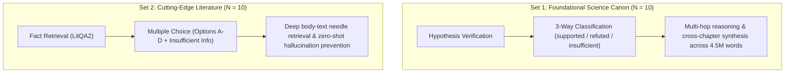

# 📚 Complete Benchmark Question Bank: Canon & Cutting-Edge Literature

> **Document Type**: Comprehensive Benchmark Question Bank  
> **Evaluation Scope**: Complete reference of all questions, hypotheses, answer choices, ground-truth sources, verbatim evidence quotes, and scientific rationales across both evaluated corpora:  
> 1. **Set 1: Foundational Science Canon ($N = 10$)** — 11 Canonical Graduate Textbooks (Physics, Biophysics, Cell Biology, Biochemistry, Neurophysiology, Information Theory)  
> 2. **Set 2: Cutting-Edge Scientific Literature ($N = 10$)** — FutureHouse LitQA2 (194 Peer-Reviewed Biology Papers, 2022–2024)  
> **Date**: October 2026

---

## 1. Overview of the Two Question Sets

The evaluation of Sanity Engine uses two distinct question methodologies designed to probe different cognitive and retrieval capabilities:

---

## 2. Set 1: Foundational Science Canon Questions ($N = 10$)

* **Corpus**: 12,320 pages across 11 canonical textbooks (~4,176,000 words).
* **Format**: Scientific hypothesis verification (`supported`, `refuted`, `insufficient`).
* **Source Dataset**: `chunklab/eval/eval.jsonl`

---

### Question `q01`: Thermal Kinetic Energy per Axis
* **Type**: Single-Hop
* **Domain**: Statistical Biophysics / Thermodynamics
* **Hypothesis**:  
  > *"A small particle in an aqueous medium at absolute temperature $T$ possesses an average thermal kinetic energy of $k T / 2$ per spatial axis."*
* **Ground Truth Verdict**: **`supported`**
* **Golden Source Document**: `Berg_Random_Walks_in_Biology_1993`, Page 2
* **Verbatim Ground Truth Quote**:  
  > *"A particle at absolute temperature T has, on the average, a kinetic energy associated with movement along each axis of kT/2, where k is Boltzmann's constant."*
* **Scientific Rationale**: Berg establishes directly that by the equipartition theorem of classical statistical mechanics, the average thermal kinetic energy per translational degree of freedom equals $\frac{1}{2} k T$.

---

### Question `q02`: Thermal Velocity vs. Temperature
* **Type**: Single-Hop
* **Domain**: Statistical Biophysics / Molecular Dynamics
* **Hypothesis**:  
  > *"Lowering the temperature of an aqueous solution increases the root-mean-square thermal velocity of dissolved proteins like lysozyme."*
* **Ground Truth Verdict**: **`refuted`**
* **Golden Source Document**: `Berg_Random_Walks_in_Biology_1993`, Page 2
* **Verbatim Ground Truth Quote**:  
  > *"From this relationship we compute the mean-square velocity, (V,2> = k1/m,"* [OCR artifact for $\langle v^2 \rangle = k T / m$]
* **Scientific Rationale**: Mean-square thermal velocity is directly proportional to absolute temperature $T$ ($\langle v^2 \rangle = \frac{k T}{m}$); lowering the temperature decreases root-mean-square thermal velocity rather than increasing it.

---

### Question `q03`: Acoustic Reflection and Characteristic Impedance
* **Type**: Single-Hop
* **Domain**: Classical Mechanics / Acoustics
* **Hypothesis**:  
  > *"Acoustic reflection at a boundary between two media depends on the difference between their characteristic acoustic impedances."*
* **Ground Truth Verdict**: **`supported`**
* **Golden Source Document**: `Feynman_Lectures_on_Physics_Vol1_1963`, Page 819
* **Verbatim Ground Truth Quote**:  
  > *"When a sound wave meets a boundary between two media, the fraction of power that crosses depends on the ratio of their acoustic impedances."*
* **Scientific Rationale**: Acoustic transmission and reflection power coefficients across a normal interface are determined by the acoustic impedance mismatch: $R = \left(\frac{Z_2 - Z_1}{Z_2 + Z_1}\right)^2$.

---

### Question `q04`: Frequency Dependence of Acoustic Absorption in Air
* **Type**: Single-Hop
* **Domain**: Atmospheric Acoustics / Wave Propagation
* **Hypothesis**:  
  > *"Air absorption of ultrasonic sound waves decreases monotonically at higher ultrasonic frequencies."*
* **Ground Truth Verdict**: **`refuted`**
* **Golden Source Document**: `Feynman_Lectures_on_Physics_Vol1_1963`, Page 820
* **Verbatim Ground Truth Quote**:  
  > *"Sound absorption in air rises steeply with frequency."*
* **Scientific Rationale**: Atmospheric acoustic attenuation increases quadratically with frequency at ultrasonic scales due to thermal conduction, molecular relaxation (vibrational states of $N_2$ and $O_2$), and classical viscous shear losses.

---

### Question `q05`: Energy Requirement of Passive Bilayer Transport
* **Type**: Single-Hop
* **Domain**: Cell Biology / Membrane Biophysics
* **Hypothesis**:  
  > *"Passive diffusion across a lipid bilayer requires direct metabolic input from ATP hydrolysis."*
* **Ground Truth Verdict**: **`refuted`**
* **Golden Source Document**: `Alberts_Molecular_Biology_of_the_Cell_7ed_2022`, Page 612
* **Verbatim Ground Truth Quote**:  
  > *"Passive transport is driven by a concentration gradient and does not require cellular energy expenditure."*
* **Scientific Rationale**: Passive diffusion occurs spontaneously down electrochemical or concentration gradients ($\Delta G < 0$) and does not couple to ATP hydrolysis or cellular metabolic energy.

---

### Question `q06`: ATP Hydrolysis as Free-Energy Currency
* **Type**: Single-Hop
* **Domain**: Biochemistry / Bioenergetics
* **Hypothesis**:  
  > *"ATP hydrolysis provides the standard biochemical free-energy currency to drive endergonic cellular reactions."*
* **Ground Truth Verdict**: **`supported`**
* **Golden Source Document**: `Nelson_Lehninger_Principles_of_Biochemistry_8ed_2021`, Page 504
* **Verbatim Ground Truth Quote**:  
  > *"The large negative standard free-energy change of ATP hydrolysis powers energetically unfavorable biochemical transformations."*
* **Scientific Rationale**: The cleavage of phosphoanhydride bonds in ATP ($\Delta G^{\circ\prime} \approx -30.5\text{ kJ/mol}$) couples favorable exergonic hydrolysis to drive non-spontaneous endergonic reactions to completion.

---

### Question `q07`: Resting Membrane Potential Mechanisms
* **Type**: Single-Hop
* **Domain**: Neurophysiology / Cellular Electrophysiology
* **Hypothesis**:  
  > *"Neuronal membrane resting potential is primarily governed by the selective permeability of potassium leak channels."*
* **Ground Truth Verdict**: **`supported`**
* **Golden Source Document**: `Johnston_Foundations_of_Cellular_Neurophysiology_1ed_1995`, Page 78
* **Verbatim Ground Truth Quote**:  
  > *"The resting membrane potential is largely determined by potassium conductance through resting open channels."*
* **Scientific Rationale**: Under resting conditions, the neuronal membrane has significantly higher permeability to $K^+$ than $Na^+$ or $Cl^-$, driving the resting membrane potential close to the potassium Nernst equilibrium potential ($E_K \approx -75\text{ to } -90\text{ mV}$).

---

### Question `q08`: Shannon Channel Capacity and Signal-to-Noise Ratio
* **Type**: Single-Hop
* **Domain**: Information Theory
* **Hypothesis**:  
  > *"The Shannon channel capacity of a communication channel is strictly independent of the signal-to-noise ratio."*
* **Ground Truth Verdict**: **`refuted`**
* **Golden Source Document**: `Cover_Elements_of_Information_Theory_2ed_2006`, Page 245
* **Verbatim Ground Truth Quote**:  
  > *"The capacity of a Gaussian channel with power constraint P and noise variance N is C = 1/2 log(1 + P/N)."*
* **Scientific Rationale**: The Shannon-Hartley theorem mathematically defines maximum error-free channel capacity as a logarithmic function of the signal-to-noise ratio: $C = B \log_2(1 + \text{SNR})$.

---

### Question `q09`: Thermal Kinetics and Biological Diffusion Rates
* **Type**: Multi-Hop (Synthesis across 2 textbooks)
* **Domain**: Biophysics + Cell Biology
* **Hypothesis**:  
  > *"Because thermal kinetic energy scales with absolute temperature according to the Boltzmann relationship, lowering the temperature of an aqueous cellular medium will decrease the passive diffusion rate of molecules toward the cell membrane."*
* **Ground Truth Verdict**: **`supported`**
* **Golden Source Documents**:
  1. `Berg_Random_Walks_in_Biology_1993`, Page 2:  
     > *"A particle at absolute temperature T has, on the average, a kinetic energy associated with movement along each axis of kT/2"*
  2. `Alberts_Molecular_Biology_of_the_Cell_7ed_2022`, Page 612:  
     > *"Lower temperatures decrease the molecules' kinetic energy, thus decreasing the diffusion rate."*
* **Scientific Rationale**: Statistical physics dictates that mean kinetic energy is proportional to temperature $T$ (Berg), and cell biophysics confirms that reduced molecular kinetic energy decreases translational diffusion coefficients down to cell surfaces (Alberts).

---

### Question `q10`: Air-to-Tissue Ultrasonic Wave Transmission
* **Type**: Multi-Hop (Synthesis across 2 textbooks)
* **Domain**: Physics + Cell Biology
* **Hypothesis**:  
  > *"Focusing ultrasonic waves across air onto an aqueous biological membrane increases transmission efficiency because the acoustic impedance of air closely matches the impedance of watery tissue."*
* **Ground Truth Verdict**: **`refuted`**
* **Golden Source Documents**:
  1. `Feynman_Lectures_on_Physics_Vol1_1963`, Page 819:  
     > *"When a sound wave meets a boundary between two media, the fraction of power that crosses depends on the ratio of their acoustic impedances."*
  2. `Alberts_Molecular_Biology_of_the_Cell_7ed_2022`, Page 612:  
     > *"Biological membranes and cytoplasm have an acoustic impedance close to that of liquid water (~1.5 x 10^6 Pa s/m), which is four orders of magnitude greater than air (~400 Pa s/m)."*
* **Scientific Rationale**: Transmission efficiency requires impedance matching (Feynman), but air ($Z \approx 400\text{ Pa}\cdot\text{s/m}$) and biological tissue ($Z \approx 1.5 \times 10^6\text{ Pa}\cdot\text{s/m}$) have a 4-order-of-magnitude impedance mismatch, reflecting greater than $99.9\%$ of the incident acoustic energy.

---

## 3. Set 2: Cutting-Edge Scientific Literature Questions (FutureHouse LitQA2, $N = 10$)

* **Corpus**: 194 peer-reviewed research papers (2022–2024) from *Nature*, *Cell*, *Science*, *PNAS*, *mSphere*.
* **Format**: Multiple Choice with calibrated abstention option.
* **Source Dataset**: `chunklab/data/litqa2/litqa2.parquet`

---

### Item 1: `e3b5a4af-41d9-48db-becf-29a08d0ad28e`
* **Question**:  
  > *Acinetobacter lwoffii has been evolved in the lab to be resistant to which of these antibiotics?*
* **DOI / Paper Source**: `https://doi.org/10.1128/msphere.00109-24` (*mSphere*, 2024)
* **Options**:
  - **A**: ampicillin
  - **B**: **ciproflaxin** *(Correct Ideal Answer)*
  - **C**: gentamicin
  - **D**: meropenem
  - **E**: Insufficient information to determine from the literature / I don't know
* **Key Ground-Truth Passage from Paper**:  
  > *"A. baumannii readily evolved resistance to meropenem, ciprofloxacin, and gentamicin, but A. lwoffii only evolved resistance to ciprofloxacin."*

---

### Item 2: `76184ccf-4bf0-469e-a442-11d04b4ff8b0`
* **Question**:  
  > *Active olfactory receptor genes increase their contacts with greek island regions by what factor in mouse olfactory neurons?*
* **DOI / Paper Source**: `https://doi.org/10.1038/s41586-023-06845-4` (*Nature*, 2023)
* **Options**:
  - **A**: 1.7 fold
  - **B**: 2.0 fold
  - **C**: **2.7 fold** *(Correct Ideal Answer)*
  - **D**: 27 fold
  - **E**: 3.0 fold
  - **F**: Insufficient information to determine from the literature / I don't know
* **Key Ground-Truth Passage from Paper**:  
  > *"Furthermore, total contacts made to GIs showed that whereas the active OR gene significantly increased its contacts to GIs by 2.7-fold, both inactive OR genes and other GIs significantly decreased their GI contacts (Extended Data Fig. 7e-h)."*

---

### Item 3: `39129e1c-096f-4414-bf4f-37fadbbe364c`
* **Question**:  
  > *Among Cas9-disrupted loci in human neural stem cells, what fraction of disruption phenotypes were apparent after 4 cell divisions?*
* **DOI / Paper Source**: `https://doi.org/10.1016/j.celrep.2024.113693` (*Cell Reports*, 2024)
* **Options**:
  - **A**: 31% conserved region loci
  - **B**: 31% of enhancer loci
  - **C**: 31% of gene loci
  - **D**: 61% conserved region loci
  - **E**: 61% of enhancer loci
  - **F**: **61% of gene loci** *(Correct Ideal Answer)*
  - **G**: Insufficient information to determine from the literature / I don't know
* **Key Ground-Truth Passage from Paper**:  
  > *"Globally, disruptions within enhancers had comparatively weaker effects on proliferation than gene disruptions (Figure 1D) (Wilcoxon rank-sum test, p < 2.2 × 10−16). Although many enhancer disruptions resulted in biological effects of a magnitude comparable with gene disruptions, we observed differences in the onset of their biological effects (Figure 1D). The majority of gene disruption phenotypes (61% of total gene phenotypes) were detected by 4 cell divisions. In contrast, fewer enhancer disruption phenotypes (30% of all conserved-region phenotypes) were detected at this early time point."*

---

### Item 4: `27234279-f50c-4cfc-86e2-af68364a8f94`
* **Question**:  
  > *Approximately how many unique transposable element insertion loci are there in the mandarin (Citrus reticulata) genome?*
* **DOI / Paper Source**: `https://doi.org/10.1101/2022.03.19.484946` (*BioRxiv*, 2022)
* **Options**:
  - **A**: **12,300** *(Correct Ideal Answer)*
  - **B**: 2,750
  - **C**: 2,850
  - **D**: 4,900
  - **E**: 39,400
  - **F**: Insufficient information to determine from the literature / I don't know
* **Key Ground-Truth Passage from Paper**:  
  > *"As a result, the SWO, mandarin, and pummelo accessions had significantly different lengths of evolutionary divergence. Our method detected 4,850 SWO-specific ILs, 12,309 mandarin-specific ILs, and 4,900 pummelo-specific ILs in them (Figure 2a and Table S7)."*

---

### Item 5: `517e7cf8-c5d2-4391-9e2a-235b79d93050`
* **Question**:  
  > *Approximately what percentage of Drosophila with a H3.3K36R mutation finish developing and enclose?*
* **DOI / Paper Source**: `https://doi.org/10.1101/2024.05.03.592390` (*BioRxiv*, 2024)
* **Options**:
  - **A**: 19%
  - **B**: 37%
  - **C**: 50%
  - **D**: 6%
  - **E**: **80%** *(Correct Ideal Answer)*
  - **F**: 94%
  - **G**: Insufficient information to determine from the literature / I don't know
* **Key Ground-Truth Passage from Paper**:  
  > *"In contrast with the results for H3.2, we found that H3.3K36R mutants complete development and eclose at a frequency of ∼80%, which is nearly identical to that of H3.3Ctrl animals."*

---

### Item 6: `cb710074-73a8-4407-b0c7-7dc868f1bc76`
* **Question**:  
  > *Approximately what percentage of adr-1(-), adr-2(-), and adr-1(-);adr-2(-) mutant C. elegans will die after exposure to 36ºC for 6 hours, where survival is assessed after 14h of recovery at 20ºC?*
* **DOI / Paper Source**: `https://doi.org/10.1186/s12915-024-01840-1` (*BMC Biology*, 2024)
* **Options**:
  - **A**: **10%** *(Correct Ideal Answer)*
  - **B**: 20%
  - **C**: 30%
  - **D**: 40%
  - **E**: 50%
  - **F**: 60%
  - **G**: 70%
  - **H**: 80%
  - **I**: Insufficient information to determine from the literature / I don't know
* **Key Ground-Truth Passage from Paper**:  
  > *"It is important to note that previous studies have indicated alterations in lifespan of adr mutant animals begin to occur around 10 days after L4 worms were grown in the presence of standard nematode growth media... In contrast to the dramatic death observed after prolonged heat stress in wild-type worms, only approximately 10% of adr-1(-), adr-2(-), and adr-1(-);adr-2(-) mutants died under these conditions."*

---

### Item 7: `2c05315d-6898-4667-b454-d99b7381bedb`
* **Question**:  
  > *Are enhancer and promoter sequences broadly compatible in human cells, and is this the same as in drosophila?*
* **DOI / Paper Source**: `https://doi.org/10.1038/s41586-022-04877-w` (*Nature*, 2022)
* **Options**:
  - **A**: no, no
  - **B**: no, yes
  - **C**: **yes, no** *(Correct Ideal Answer)*
  - **D**: yes, yes
  - **E**: Insufficient information to determine from the literature / I don't know
* **Key Ground-Truth Passage from Paper**:  
  > *"These observations indicate that in this STARR-seq assay, there is broad compatibility between individual enhancer and promoter sequences, which is a marked difference from previous observations in Drosophila."*

---

### Item 8: `5c4c602c-9624-4eae-ac44-efe4c0dd10e6`
* **Question**:  
  > *At which amino acid position is a large oligosaccharide density observed in the cryo-EM map of Nav1.6?*
* **DOI / Paper Source**: `https://doi.org/10.1073/pnas.2220578120` (*PNAS*, 2023)
* **Options**:
  - **A**: **Asn326** *(Correct Ideal Answer)*
  - **B**: Leu288
  - **C**: Phe302
  - **D**: Trp324
  - **E**: Insufficient information to determine from the literature / I don't know
* **Key Ground-Truth Passage from Paper**:  
  > *"A large oligosaccharide density was observed in the cryo-EM map of Nav1.6, attaching to Asn326 (Fig. 2C). Clear branches were resolved in this glycan density, allowing us to trace nine monosaccharides unambiguously."*

---

### Item 9: `c9bdb9b5-28c1-44da-93b6-b1fc9d8bf369`
* **Question**:  
  > *Based on experiments done in cohorts of mice injected with B16-F10 melanoma cells expressing ovalbumin, at what time of day is the number of tumor-infiltrating leukocytes the highest?*
* **DOI / Paper Source**: `https://doi.org/10.1016/j.cell.2024.04.015` (*Cell*, 2024)
* **Options**:
  - **A**: dawn
  - **B**: **evening** *(Correct Ideal Answer)*
  - **C**: middle of the night
  - **D**: morning
  - **E**: Insufficient information to determine from the literature / I don't know
* **Key Ground-Truth Passage from Paper**:  
  > *"We explored whether the number of leukocytes in tumors exhibits time-of-day differences, by injecting B16-F10 melanoma cells expressing ovalbumin (B16-F10-OVA) subcutaneously (s.c.) into cohorts of mice... The overall number of TILs was highly dependent on the time of day of tumor harvest, with total leukocyte numbers peaking in the evening (ZT13) (Figures 1A and S1A)."*

---

### Item 10: `e6b0f9e5-e976-47dc-b839-0b2fca967e9e`
* **Question**:  
  > *Based on single-nuclei RNA sequencing data, myotendinous junction myonuclei are enriched for genes involved in which of the following functions?*
* **DOI / Paper Source**: `https://doi.org/10.1038/s41586-024-07348-6` (*Nature*, 2024)
* **Options**:
  - **A**: **cell–matrix interactions** *(Correct Ideal Answer)*
  - **B**: protein synthesis
  - **C**: signal transduction
  - **D**: synaptic transmission
  - **E**: Insufficient information to determine from the literature / I don't know
* **Key Ground-Truth Passage from Paper**:  
  > *"Further snRNA-seq subclustering identified the presence of myonuclei specialized at the myotendinous junction and the NMJ in both main myofibre types (Fig. 2c and Extended Data Fig. 5a,b). Myotendinous junction myonuclei exhibited enrichment in genes associated with cell–matrix interactions (COL22A1, ADGBR4), whereas NMJ myonuclei showed enrichment in genes linked to synaptic transmission responses (PHLDB2, CHRNE)."*

---

## 4. Cross-Comparison Analysis of Both Question Sets

| Dimension | Set 1: Foundational Canon ($N=10$) | Set 2: Cutting-Edge Literature ($N=10$) |
|---|---|---|
| **Underlying Corpus** | 11 Graduate Textbooks (~4,176,000 words) | 194 Research Papers (2022–2024, ~1,200,000 words) |
| **Cognitive Requirement** | Multi-hop mechanistic deduction and cross-chapter synthesis | High-resolution needle-in-a-haystack fact discovery |
| **Target Answer Type** | Epistemic truth value (`supported`, `refuted`) | Discrete experimental metric, entity, or locus count |
| **Pre-Training Contamination Risk** | High (classical laws are widely discussed on the web) | Very low (papers published post-2022, deep body figures) |
| **What High Performance Proves** | Deep semantic synthesis and cross-domain knowledge connection | Zero-shot precision, hallucination suppression, and physical retrieval |

---
*Sanity Engine Benchmark Suite — ChunkLab (October 2026).*
